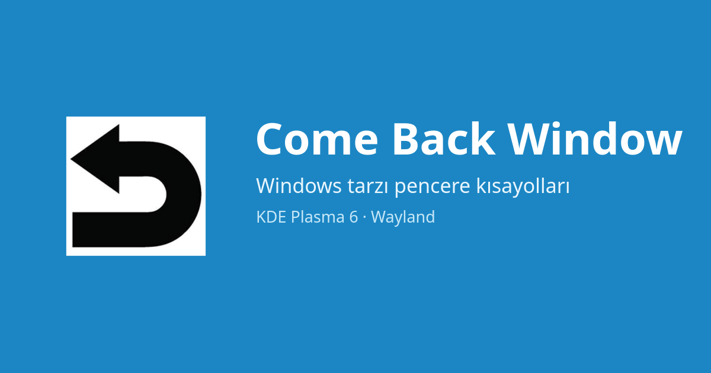

# Come Back Window



Windows tarzı pencere kısayolları, Aero Peek, Aero Shake ve "Masaüstünü Göster"
şeridi — KDE Plasma 6 (Wayland) için.

Come Back Window, Windows'ta alışık olduğunuz pencere davranışlarını KDE
Plasma 6'ya taşır:

- Masaüstünü göster / geri getir (Meta+D, Meta+M)
- Aktif pencereyi küçült, büyüt, eski boyuta getir, kapat
- Aktif hariç hepsini küçült (Meta+Home) ve geri getir (Meta+Shift+M)
- Görev çubuğunun en sağındaki ince "Masaüstünü Göster" şeridi
- Aero Peek: şeridin üstünde beklerseniz pencereler şeffaflaşır
- Aero Shake: pencereyi sallayınca diğerleri küçülür (varsayılan kapalı)
- Geri oku logosu, Türkçe/İngilizce arayüz, ilk açılış penceresi

## Kısayollar

| İşlev | Kısayol |
|---|---|
| Masaüstünü göster / geri getir | Meta+D, Meta+M |
| Aktif pencereyi küçült (büyükse eski boyuta) | Meta+Aşağı |
| Büyüt / eski haline getir | Meta+Yukarı |
| Aktif hariç hepsini küçült (aç/kapat) | Meta+Home |
| Küçültülenleri geri getir | Meta+Shift+M |
| Pencereyi kapat | Alt+F4 |
| Aero Shake | Pencereyi başlıktan tutup salla (ayarlardan açılır) |

## Mimari

- `comebackwindow` (C11, tek süreç, GLib `GMainLoop`):
  GTK4 ilk açılış/ayar pencereleri, StatusNotifierItem tepsi, dbusmenu,
  Wayland layer-shell (veya X11 dock) köşe şeridi, Aero Peek zamanlayıcısı,
  yapılandırma/autostart/kısayol yönetimi ve `org.comebackwindow.App` D-Bus
  servisi.
- `kwin/` (QML + saf JS): KWin içinde kısayollar, pencere işlemleri, panel
  geometrisi, Aero Peek opaklık animasyonu ve Aero Shake algılama. Mantık
  `kwin/contents/code/logic.js` içinde KWin'den bağımsız tutulur ve `node
  --test` ile test edilir.

Uygulama ile betik arasındaki komut kanalı birincil olarak
`org.kde.kglobalaccel` `/component/kwin` `invokeShortcut` üzerinden çalışır;
başarısız olursa betik `PollCommands()` yoklamasına geçer. Ayrıntılar:
`docs/KARARLAR.md`.

## Derleme ve kurulum

```bash
make deps-check
make
sudo make install
```

Gereksinimler (Fedora):

```bash
sudo dnf install gcc make pkgconf-pkg-config glib2-devel gtk4-devel \
  wayland-devel wayland-protocols-devel libX11-devel gettext \
  librsvg2-tools desktop-file-utils libappstream-glib appstream nodejs
```

Arch:

```bash
sudo pacman -S --needed base-devel glib2 gtk4 wayland wayland-protocols \
  libx11 gettext librsvg desktop-file-utils appstream nodejs
```

## Test

```bash
make check              # lint + birim + JS + doğrulama
make test-asan          # ASan/UBSan
make test-valgrind      # valgrind (kuruluysa)
make test-integration   # gerçek KWin oturumunda uçtan uca
tools/check-all.sh      # hepsini sırayla çalıştırır
```

Manuel test listesi: `docs/MANUEL-TEST.md`. Test raporu: `docs/TEST-RAPORU.md`.

## Lisans

MIT — bkz. `LICENSE`.
