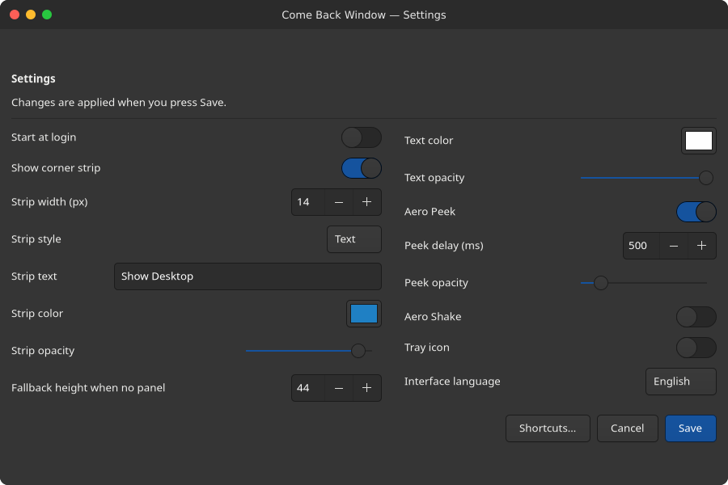
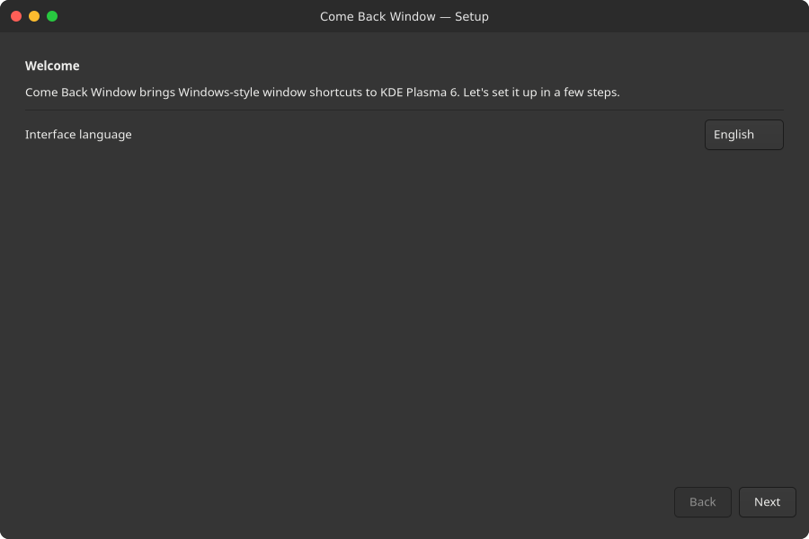

<h1 align="center">Come Back Window</h1>

<p align="center">Windows-style window shortcuts, Aero Peek and a Show Desktop strip for KDE Plasma 6 on Wayland.</p>

## Screenshots

<p align="center">
  
</p>

<p align="center">
  
</p>

## Features

- Show Desktop toggle: `Meta+D`, `Meta+M`, tray menu, or the corner strip
- Window shortcuts: minimize, maximize, close, minimize others, restore all
- Show Desktop strip pinned to the bottom-right corner and aware of the panel
- Optional text mode: vertical label with custom text, color and opacity
- Aero Peek: windows fade while the pointer rests on the strip
- Aero Shake: shake a window to minimize the others (off by default)
- Tray icon with an eight-item menu
- GTK4 settings window and first-run wizard
- Turkish and English interface
- KDE Plasma 6 on Wayland; an X11 fallback strip is included

## Installation

Build and run from source:

```bash
git clone https://github.com/colgecen/ComeBackWindow.git
cd ComeBackWindow
./comebackwindow --install
```

`--install` is a one-time step: it adds **Come Back Window** to the
application launcher (with its icon) and lets you type `comebackwindow`
(no `./`) to open the build menu:

```bash
comebackwindow
```

Prebuilt packages are available on the
[Releases](https://github.com/colgecen/ComeBackWindow/releases) page.

## Usage

Run the app straight from source (press `Ctrl+C` to stop):

```bash
./comebackwindow
```

The first start opens the setup wizard. Use the tray icon or
`./comebackwindow --settings` to change the strip style, text, colors and
opacity, Aero Peek/Shake and autostart. Configuration lives in
`~/.config/comebackwindow/config.ini`.

## License

This project is licensed under the [MIT](LICENSE) license.
